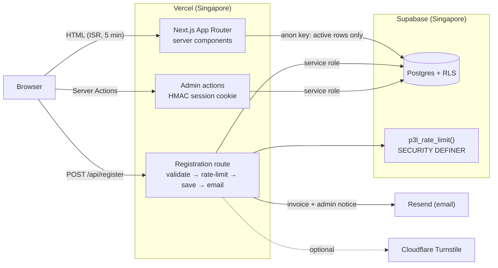

# P3L: Training & Wastewater Consulting Platform

**The production website of an Indonesian wastewater-treatment (IPAL) training and consulting business: public site, class registration with e-invoicing, and an admin dashboard.**


> **Live in production:** [pengolahanlimbahcair.com](https://pengolahanlimbahcair.com)
>
> This repository is a **sanitized showcase** of that codebase. The code is the same, but contact details, bank account, client list, instructor profile and photos have been replaced with fictional placeholders. The production repository is private.

<!-- Screenshots: add docs/screenshots/{home,jadwal,invoice,admin}.png and uncomment.
| Home | Schedule & registration | E-invoice | Admin |
|---|---|---|---|
|  |  |  |  |
-->

## What it does

The business runs government-certified (BNSP) training for wastewater-plant operators, plus engineering consulting. Before this site, every registration came in over WhatsApp and every invoice was typed by hand.

| For | Features |
|---|---|
| **Visitors** | Program and service pages, live class schedule with filters, syllabus viewer, articles with auto-generated table of contents, contact and map |
| **Registrants** | Register for a class in one form. A pro-forma invoice is emailed immediately and can also be printed or saved from the browser |
| **Admin** | Password-protected dashboard: create/edit schedules and articles, track registrations and payment status, and every public page refreshes on save |
| **Search engines** | Per-page metadata, dynamic Open Graph images, JSON-LD structured data (Organization, Course, Person, FAQ), sitemap, and `noindex` for thin pages |

## Architecture



**The browser never talks to the database.** All Supabase access happens in server components, the route handler and server actions, so the CSP `connect-src` does not list Supabase at all. Public reads use the anon key restricted by RLS to active rows. Writes use the service-role key, which can only be imported from server modules (`import 'server-only'` fails the build otherwise).

## Security engineering

This is a small business site, but it takes payments-adjacent personal data (name, institution, phone, email), so it was hardened like one:

- **Row-level security.** The public can read only active schedules and articles. The `registrations` table has *no* policy, so only the server can touch personal data. See [`supabase/rls.sql`](supabase/rls.sql).
- **Rate limiting that survives serverless.**
  - Registration is capped per IP, per email and globally; admin login per IP and globally.
  - Counters live in Postgres behind a `SECURITY DEFINER` function, so they hold across Vercel instances and cold starts. If the database is unreachable, the limiter falls back to in-memory counting instead of failing open.
  - Keys are SHA-256 hashed so raw IPs and emails are never stored.
  - **IPv6 addresses are collapsed to their /64**, so rotating addresses inside one customer block doesn't reset the limit.
  - [`lib/rate-limit.ts`](lib/rate-limit.ts), [`lib/request.ts`](lib/request.ts).
- **A login that can't be used to lock out the real admin.** A successful login sets a 90-day "trusted device" cookie, and that device bypasses the global login limit. An attacker spraying from many IPs therefore can't lock the owner out. The token is bound to the password, so rotating the password revokes every trusted device.
- **The registration endpoint can't be turned into a phishing relay.** Form fields are echoed into the invoice email, so they reject links, bare domains and markup. Values are HTML-escaped in the email, the endpoint checks `Origin`, caps the body size (even without `Content-Length`), and has a honeypot field.
- **Prices come from the database.** The browser sends only a schedule ID. Title and price are read server-side, and the same email can't receive a second invoice for the same class within 24 hours.
- **Headers.** Strict CSP, HSTS, `X-Frame-Options`, `Permissions-Policy`, and `no-store` + `noindex` on `/admin` and `/api`. See [`next.config.mjs`](next.config.mjs).
- **Admin session.** An httpOnly cookie signed with HMAC-SHA256 holds the expiry. Comparisons are constant-time, and rotating `ADMIN_SESSION_SECRET` logs everyone out.

## Tests and CI

| Suite | What it covers |
|---|---|
| [`tests/register.test.ts`](tests/register.test.ts) | The real registration route with the database, rate limiter and email faked: origin check, body cap, honeypot, every validation rule, rate-limit response, closed/unknown class, duplicate-invoice guard, and that the stored title comes from the database |
| [`tests/request.test.ts`](tests/request.test.ts) | Client IP resolution (platform header precedence, IPv4-mapped IPv6, /64 collapse, zone index) and same-origin checks |
| [`tests/admin-auth.test.ts`](tests/admin-auth.test.ts) | Password check, session token expiry, tampered expiry, secret rotation |
| [`scripts/smoke-test.mjs`](scripts/smoke-test.mjs) | End-to-end smoke test against a deployed URL |

GitHub Actions runs `lint`, `typecheck`, `test` and `build` on every push.

## Running locally

```bash
pnpm install
cp .env.example .env.local     # fill in your Supabase project + an admin password
pnpm dev                       # http://localhost:3000
pnpm lint && pnpm typecheck && pnpm test
```

To set up a new Supabase project, run the SQL files in the order listed at the top of [`supabase/schema.sql`](supabase/schema.sql). `seed.sql` adds fictional demo classes and articles.

## Tech stack

Next.js 16 (App Router, Server Actions, ISR, dynamic OG images) · React 19 · TypeScript · Tailwind CSS 4 · Supabase (Postgres, RLS, PL/pgSQL) · Resend · Cloudflare Turnstile · Vercel (Singapore region, next to the database) · Vitest · GitHub Actions

## About this repository

I built and maintain the production site. This copy is generated from the private repository by a script that removes business and personal data and then refuses to finish if any real identifier remains. The UI text is in Indonesian because the users are Indonesian.

**Author:** Vacelnino Faiz Fadeli · [GitHub](https://github.com/vacelni) · [LinkedIn](https://linkedin.com/in/vacelnino-faiz-fadeli)
